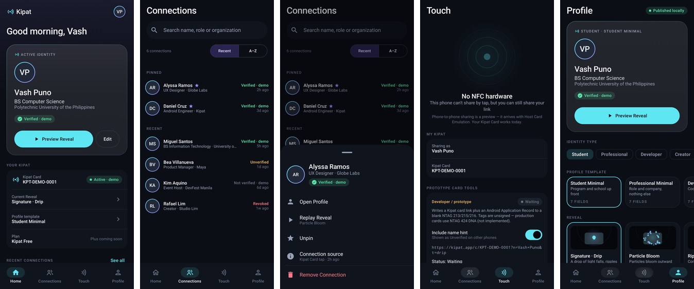

# Kipat

Kipat is an Android-first identity and connection product. Tapping a Kipat Card (or, later, a
Kipat phone) opens a short, premium **Reveal** *above whatever app the other person was using*:
name, avatar, role and organization appear with their authenticity state, and they can Connect,
Open, or dismiss straight back to their app.

This repository started as a Java/XML diagnostic probe. It is now the first Kipat product
shell in Kotlin + Jetpack Compose. The probe's working NFC tag writer and deep link were
migrated, not discarded.



## What works today

| Area | Status |
|---|---|
| 3-tab shell (Home, Connections, Profile) + Share | Working — Quiet Graphite design system, Compose + Material 3, edge-to-edge, per-tab state saved/restored, light & dark |
| Reveal (`TapExperienceActivity`) | Working — translucent, own task, dynamic payload, six-template family (Contact Ripple default; Precision Orbit, Line Assembly, Aperture, Spatial Card, Minimal Fade), Preview-before-Apply picker, per-template reduced-motion equivalents |
| Preview / Replay Reveal | Working — Home, Profile and Connections launch the same renderer |
| Debug deep link `kipatprobe://tap/…` | Working — routes into the Reveal |
| Kipat Card NFC tap → Reveal | Implemented (NDEF filter + parser + resolver); **not yet tested on a physical device** |
| Share screen (QR, copy link, system share, card state) | Working; links point to kipat.app, which has **no web profile yet** |
| Save contact | Working — one tap into Android Contacts (ACTION_INSERT), no .vcf |
| Prototype NTAG writer | Profile → Developer tools; **not yet re-tested on hardware** after migration |
| Connections, taps, profile publishing | **Local demo data, in memory** — resets when the process dies |
| Authenticity / verification | **Not implemented.** Sample data shows "Verified · demo"; tag-supplied names show "Unverified" |
| Self-contained NFC test profile cards | Implemented (Developer tools → NFC full profile test); **not yet tested on hardware** |
| Kipat Tap: phone-to-phone NFC from any app | **Implemented and simulated; physical validation required.** Touch two unlocked phones, Kipat not open: a Type 4 NDEF bootstrap launches Kipat on the reading phone, which then exchanges profiles with the HCE phone; both are meant to show a Reveal; never auto-connects. One-time consent; setting under Profile ([`docs/nfc-phone-to-phone.md`](docs/nfc-phone-to-phone.md), [feasibility](docs/nfc/ambient-peer-feasibility.md)). The manual Present/Receive mode is under Developer tools |
| Kipat Plus, billing, backend, NTAG 424 | Not implemented (placeholders only) |

## Build

Requirements: JDK 21+, Android SDK with platform 37 (`local.properties` → `sdk.dir=…`).

```bash
./gradlew :app:assembleDebug        # APK in app/build/outputs/apk/debug/
./gradlew :app:testDebugUnitTest    # JVM unit + Robolectric smoke tests
./gradlew :app:lintDebug
```

Toolchain: AGP 9.4.1 (built-in Kotlin 2.2.10), Gradle 9.6.0, compileSdk/targetSdk 37,
**minSdk 26**. Compose BOM 2026.08.00.

Optional: `-Pkipat.screenshots=true` writes smoke-test PNGs to
`app/build/outputs/kipat-screenshots/`. If Maven Central rate-limits Robolectric's
`android-all` download, pass `-Probolectric.dependency.repo.url=<mirror>`.

## Trigger the Reveal without a tag

```bash
adb shell am start -W -a android.intent.action.VIEW -d "kipatprobe://tap/TEST123"   # unknown card shell
adb shell am start -W -a android.intent.action.VIEW -d "kipatprobe://tap/demo"      # your own demo identity
adb shell am start -W -a android.intent.action.VIEW \
  -d "kipatprobe://tap/KPT-X1?n=Sam%20Reyes&s=Designer&t=particle-bloom&a=revoked"
adb logcat -s KipatReveal                                                            # timing markers
```

Profile → Developer tools → *Test the Reveal* has the same triggers as buttons. See [`docs/reveal.md`](docs/reveal.md).

## Prototype NFC tag writing

Profile → **Developer tools** → *Write to tag*, then hold a blank NTAG 213/215/216 to the
phone. It writes `https://kipat.app/c/<cardId>[?n=<name>&t=<template>]` plus an Android
Application Record. Tapping that tag on a phone with Kipat installed opens the Reveal.
Foreground dispatch is only active while a write is armed on the Developer tools screen. Details: [`docs/nfc.md`](docs/nfc.md).

## Architecture

```
app/src/main/java/com/kipat/probe/
  MainActivity.kt            Compose root + armed tag writer
  TapExperienceActivity.kt   translucent Reveal host (NFC, deep link, preview, replay)
  navigation/                tabs + NavHost
  ui/theme, ui/components    design tokens and shared components
  ui/screens/{home,share,connections,profile,developer}
  reveal/                    payload, catalog, timeline engine, RevealScreen, effects/
  nfc/                       physical cards: URI parser, tag writer, write controller
  nfc/profile/               shared public-profile JSON + NDEF codec (cards and phone-to-phone)
  nfc/peer/                  phone-to-phone: HCE service, APDU protocol/processor, IsoDep reader
  model/, data/              domain models, in-memory repository, resolver
```

More: [`docs/architecture.md`](docs/architecture.md).

## Design

Kipat's design rationale and rules live in `design/`: research (`research/reference-matrix.md`),
audit, principles (`KIPAT_DESIGN_PRINCIPLES.md`), the token foundation (`system/foundation.md`),
the chosen direction (*Quiet Graphite*) and the post-redesign review. Future sessions should
follow `.claude/skills/kipat-product-design/SKILL.md`.

## Design references (Higgsfield)

[`design/higgsfield/`](design/higgsfield/) holds the brief, exact prompts, the credit-guarded
script and critiques for two rounds. v1 (4 credits) was rejected as generic AI concept art. v2
(4 credits) was generated only after the design direction was chosen, with text-free geometric
prompts: a Quiet Graphite card board (adopted), an Editorial board (backup, not adopted) and a
Reveal motion reference whose contact ring, symmetric edge trace and name wipe are now native.
Higgsfield output is art direction only, never the runtime.

## Known limitation: backdrop varies by device

The Reveal relies on a translucent window in its own task so the previous app stays visible.
Whether that app keeps rendering live, freezes, or is replaced by the launcher/wallpaper is
OEM- and version-dependent (the earlier probe measured this per device). The Samsung / Xiaomi /
Pixel backdrop matrix is **still to be validated on physical devices**; nothing here was
verified on an emulator or real phone.

The package/application ID remains `com.kipat.probe` intentionally.
