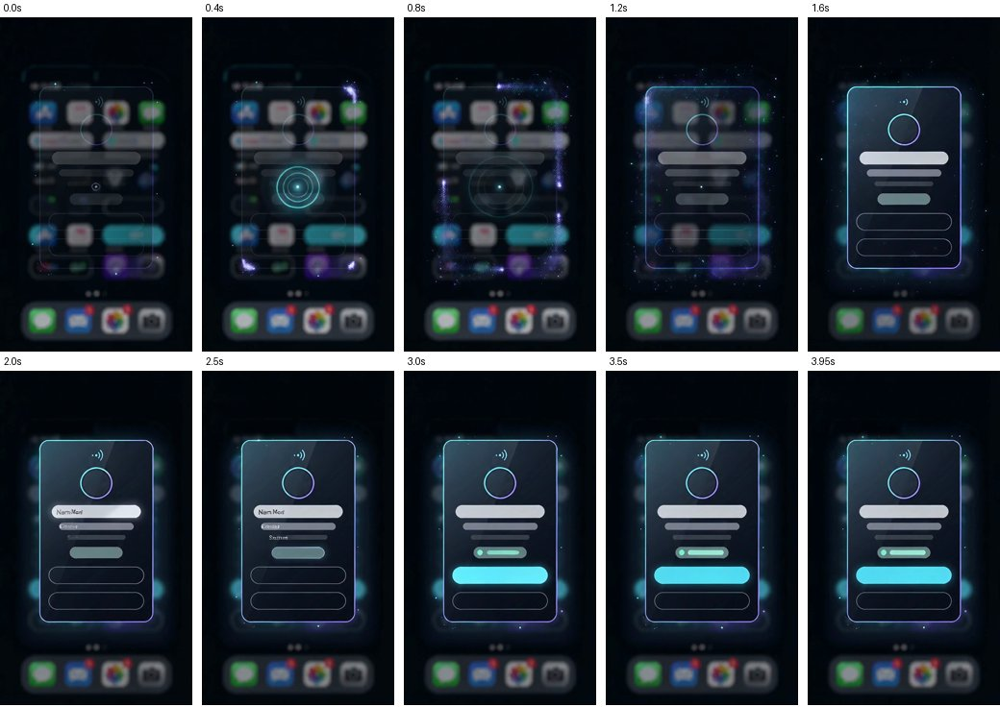

# Higgsfield art direction — Kipat Signature Reveal

Higgsfield is used for **visual/motion reference only**. The shipped Reveal is native Compose
(`app/src/main/java/com/kipat/probe/reveal/`) driven by a dynamic `RevealPayload`. No
Higgsfield output is bundled in the APK, and the generated video is not committed.

```
Higgsfield keyframe + clip  →  extract motion language  →  Compose primitives  →  dynamic payload
```



## What was generated (2026-10-13)

All via the official Higgsfield CLI (`@higgsfield/cli` 1.1.26) in the private workspace.
Prompts are exactly those in `signature-reveal-prompt.md` (v2 adds one line, recorded there).

| # | Job ID | Model | Params | Credits | Result |
|---|---|---|---|---|---|
| 1 | `a4acfa09-9b5e-4679-a61c-21301457dd02` | Nano Banana 2 Lite (`nano_banana_2_lite`) | 9:16, 1k | 1 | Good card frame, but rendered the label "Role/program" and ghost text "Display name" |
| 2 | `8a943dec-7861-47af-8533-ffa094239c22` | Nano Banana 2 Lite | 9:16, 1k, + "zero typography" line | 1 | Same label again — the model literalises "role/program bar". Not used |
| 3 | `555bd1ef-97f8-4a89-8323-f7a0d0d7274d` | Seedance 2.0 Mini (`seedance_2_0_mini`) | 9:16, 480p (496×864, 24 fps), 4 s, silent, `--end-image` = retouched #1 | 2 | **Selected motion reference** |

Total spent: **4 credits** (account transactions confirm 1 + 1 + 2).

**Retouch disclosure:** before using #1 as the clip's end frame, the two pieces of model-rendered
text were painted out locally (flat grey bar / background fill) so no text propagated into the
motion. Originals are kept as `references/signature-keyframe-v1-original.png` and `-v2-original.png`;
the edited end frame is `references/signature-keyframe-endframe.png`.

**Files:** `references/` holds the three keyframes (360 px), seven clip stills at 0.4–3.95 s
(240 px) and the contact sheet. The MP4 (≈0.8 MB) was kept outside git (`out/`, ignored). It
remains in the account's Higgsfield history under job #3.

**Usage:** design reference only — not shippable product art.

## Selected direction and verdict

Adopted into the native runtime (see `implementation-notes.md`):

1. **Progressive scrim** — the app underneath stays legible at the tap, then dims as the card
   resolves (clip 0.4 → 1.6 s).
2. **Perimeter trace** — light traces the card's outline before the glass fills in (clip 0.8 s).
3. Confirms: concentric tap ripple, faint halo, calm settle, cyan primary CTA last.

Rejected:

- The invented backdrop is a blurred **iPhone-style home screen** — off-brief and someone else's
  UI. Kipat never draws a fake underlying app; the real one shows through the translucent window.
- **Gibberish text** in the name bars at 2.0–2.5 s.
- **Pacing ~2× slower** than the spec (card ~1.4 s, CTA ~3.0 s vs 600 / 1800 ms). The native
  timeline keeps the spec targets.
- Ripple centred on the card rather than the tap point — native keeps the signature drip from the
  tap point.

## Re-running

`./design/higgsfield/generate.sh` (prints the cost and asks before each paid step). It needs
`higgsfield auth login`; from a cloud container, open the sign-in URL in your browser and
deliver the final `http://localhost:8765/callback?...` address back to the waiting CLI.
