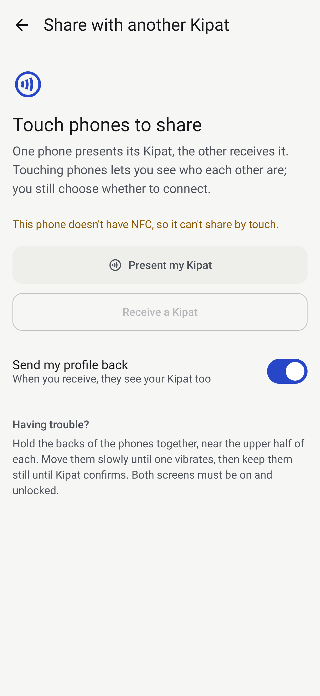
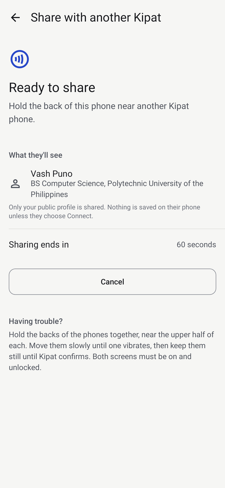
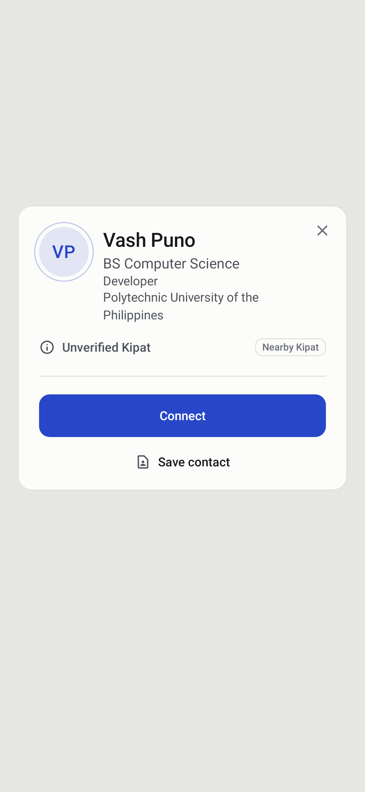

# Phone-to-phone NFC (Kipat ↔ Kipat)

**Status: IMPLEMENTED · PROTOCOL-TESTED (JVM simulation) · PHYSICAL TEST PENDING.** No two
physical phones have run this yet. Nothing here claims it works on hardware.

Kipat has two NFC architectures that solve different problems:

| | Physical card | Phone to phone |
|---|---|---|
| What's touched | an NTAG card | another phone running Kipat |
| Data model | NDEF message ([nfc.md](nfc.md), [nfc-self-contained-profile.md](nfc-self-contained-profile.md)) | ISO-DEP APDU exchange (this document) |
| Android API | NDEF dispatch, reader mode for the test tool | `HostApduService` (presenter) + reader mode / `IsoDep` (receiver) |
| Code | `nfc/`, `nfc/profile/` | `nfc/peer/` |
| Shared | the public profile JSON schema, validator and Reveal mapping (`NfcProfileFormat`, `NfcProfileReveal`) | |

## Why touching two phones showed "New tag collected / Empty tag"

A phone isn't an NFC tag. When two ordinary Android phones touch, each one's NFC controller polls
as a reader; the other may answer with whatever card emulation it has (a wallet, an OEM service,
or nothing), which carries no NDEF message. The system's generic tag viewer then reports an
empty tag. No Kipat code was involved because Kipat had no card-emulation side and was not
holding the reader.

## Why not Android Beam

Android Beam (NDEF push over LLCP/SNEP: `setNdefPushMessage`, `setNdefPushMessageCallback`) was
deprecated in Android 10 (API 29) and its APIs were removed in Android 14 (API 34). Kipat does not use it or any peer-to-peer
LLCP API.

## Architecture

```
PHONE A — "Present my Kipat"                 PHONE B — "Receive a Kipat"
KipatHceService (HostApduService)            KipatPeerReader (NfcAdapter.enableReaderMode)
  └ KipatApduProcessor (pure Kotlin)           └ IsoDep → KipatPeerExchange (pure Kotlin)
      └ PeerSessionStore (armed session)
                  ◄────── ISO-DEP / ISO 7816-4 APDUs ──────►
```

- **Presenter (card role):** `KipatHceService` is a thin `HostApduService`; every APDU goes to
  `KipatApduProcessor`. Registered in the manifest with `BIND_NFC_SERVICE`, AID group
  `category="other"` (never payment, no wallet role) and `requireDeviceUnlock="true"`.
- **Receiver (reader role):** `KipatPeerReader` enables reader mode with `FLAG_READER_NFC_A |
  FLAG_READER_NFC_B | FLAG_READER_SKIP_NDEF_CHECK | FLAG_READER_NO_PLATFORM_SOUNDS`, gets
  `IsoDep`, sets a 3 s timeout and runs the exchange on `Dispatchers.IO`, closing `IsoDep` in
  `finally`. Reader mode is on **only** while "Receive a Kipat" is active and the screen is
  resumed, so it never takes over physical card taps elsewhere. These flags are not used by
  the physical-card reader.
- **Explicit roles.** One phone presents, the other receives. No automatic role negotiation in
  v1: deterministic beats magical.

## AID

`F04B4950415401` — `F0` (first nibble F: ISO/IEC 7816-5 proprietary, unregistered) + `4B 49 50 41 54`
("KIPAT") + `01` (protocol v1). 7 bytes: inside Android's 5–16 byte range, even-length hex.
Authoritative constant: `KipatApduProtocol.AID_HEX`; also in `res/xml/kipat_apdu_service.xml`
(a unit test checks they match). The AID is public and not a secret.

## Protocol v1

Short APDUs, ISO/IEC 7816-4 style. `CLA 00` for SELECT, `CLA 80` (proprietary) for the rest.
Multi-byte integers are big-endian.

| Step | Command | Request | Response data |
|---|---|---|---|
| SELECT | `00 A4 04 00 07 F04B4950415401 00` | AID | protocol version (1 B) |
| HELLO | `80 10 00 00 11 <v> <reader session 16 B> 00` | version, random reader session id | version, presenter session id (16 B), capability flags (1 B: `01` download, `02` upload) |
| GET META | `80 20 00 00 00` | — | schema (1), length (2), SHA-256 (32), type (1: person, 2: organization) |
| READ CHUNK | `80 22 <offset hi> <offset lo> <Le>` | offset in P1-P2, Le 1–200 | profile bytes `[offset, min(offset+Le, length))` |
| BEGIN UPLOAD | `80 30 00 00 23 <schema> <len 2> <sha 32>` | receiver profile metadata | — |
| WRITE CHUNK | `80 32 <offset hi> <offset lo> <Lc> <data>` | 1–200 bytes at offset | — |
| COMMIT UPLOAD | `80 34 00 00` | — | — |
| COMPLETE | `80 3F 00 00` | — | — (ends the presenter's sharing window) |

Status words (`Sw`):

| SW | Meaning here |
|---|---|
| `9000` | OK |
| `6700` | wrong length (bad Lc/Le, oversized BEGIN, chunk > 200) |
| `6985` | conditions not satisfied: Present not armed or expired, no HELLO yet, upload not begun/incomplete |
| `6A80` | invalid data: unsupported protocol/schema version, hash mismatch, invalid profile |
| `6A82` | Kipat application unavailable (wrong AID, or a command before SELECT) |
| `6B00` | offset out of range (read past the end, write overflow) |
| `6D00` | instruction not supported |
| `6E00` | class not supported |

### Limits and chunking

- Profile: **4096 bytes** maximum, both directions. A larger own profile isn't shared ("Profile
  too large for nearby NFC sharing."); a presenter announcing more is refused before any chunk is read.
- Chunks: **≤ 200 bytes**, and never more than the reader's `IsoDep.getMaxTransceiveLength() − 6`.
  The sample profile (268 B) takes two reads.
- Uploads are written **by offset** into a buffer allocated only after BEGIN is validated; a retried
  or reordered chunk lands in the same place; COMMIT requires every byte covered.
- Integrity: SHA-256 over the whole profile, checked after the last chunk. A mismatch fails the
  exchange; partial or corrupted JSON is never parsed or shown. SHA-256 checks transfer
  integrity only — it is not identity.
- Parsing: the same hostile-input rules as a physical profile card (`NfcProfileFormat.parse`).

### Mutual exchange

```
B: SELECT → HELLO → GET META → READ… (A's profile) → verify → parse
B: [Send my profile back ON]  BEGIN → WRITE… → COMMIT (A verifies, parses, stores B)
B: COMPLETE  (A's window closes)
```

- **B → Reveal of A** right after A's profile is verified.
- **A → Reveal of B** right after a valid COMMIT. If the link drops after COMMIT, A keeps B; if it
  drops before, A discards the partial upload and returns to "Ready to share" while the window is open.
- **One-way:** with "Send my profile back" off, B skips the upload; A shows "Shared".
- **Same person:** if the received profile's id equals your own, both sides say "This is your
  own Kipat profile" — no Reveal, no recent tap, no connection.

## Sessions

- "Present my Kipat" pre-serializes the public profile, hashes it, makes a 128-bit `SecureRandom`
  session id and opens a **60-second** window. The HCE service answers `6985` to every Kipat
  command outside an armed, unexpired window. COMPLETE, Cancel, leaving the screen or expiry
  close it. Nothing is persisted; after process death nothing is armed.
- The receiver makes its own random 128-bit session id per attempt.
- Duplicate handling: the same (presenter session, profile) finishing twice within 10 s is one
  discovery — one Reveal, one recent tap. The Reveal itself still applies the existing
  1.5 s same-card debounce (`TapDebouncer`, now including `PEER_NFC`).
- `onDeactivated`: link loss or deselection clears partial uploads; a committed profile stays.

## Privacy and trust

- **Shared:** the public profile built from `Identity.publishedFields()` — the same boundary the
  Reveal uses — as `NfcProfilePayload`: id (card id), type, name, headline, organisation, role,
  bio, avatar URL (https only; never image bytes), website/GitHub/LinkedIn as https links,
  public email, accent, Reveal template. Only fields the active profile template publishes.
- **Never shared:** tokens, passwords, logins, device identifiers (IMEI, Android ID), location,
  contacts, hidden/private fields.
- **Trust:** a received profile is shown as **Unverified Kipat** with a **Nearby Kipat** note.
  Any app can emulate this AID; HCE is a transport, not cryptographic identity.
- **No automatic connection.** Touching records a discovery (recent tap). Only **Connect** on the
  Reveal creates a (local) connection, labelled "Phone tap". No cloud sync exists.
- **Offline:** works with no internet or backend; avatars fall back to the monogram.

### What this proves, and what it doesn't

| Proves (once tested on phones) | Does not prove |
|---|---|
| Phone-to-phone NFC discovery between Kipat apps | Who the person is (no cryptographic identity) |
| Bounded, integrity-checked data exchange | Anti-cloning, device ownership |
| Profile parsing and mutual delivery | An authenticated peer or tamper-proof exchange |
| Routing into the existing Reveal | Behaviour on phones nobody has tested |

## Logs

Tags: `KipatPeerNfc` (session), `KipatHce` (presenter service), `KipatPeerReader` (receiver),
`KipatPeerProtocol` (protocol steps). Events, no profile content or bytes:
`peer_present_started`, `peer_present_expired`, `hce_aid_selected`, `peer_hello`,
`peer_profile_meta`, `peer_profile_chunk_read`, `peer_upload_started`, `peer_upload_completed`,
`peer_exchange_success`, `peer_exchange_failed`, `peer_link_lost`, plus `reader_mode_started`,
`kipat_peer_detected`, `profile_download_started`, `profile_download_complete`.
Session ids are logged shortened (8 hex).

```
adb logcat -s KipatPeerNfc:I KipatHce:I KipatPeerReader:I KipatPeerProtocol:I KipatReveal:I
```

Android Studio Logcat filter: `tag~:KipatPeerNfc|KipatHce|KipatPeerReader|KipatPeerProtocol|KipatReveal`

Developer tools → **Phone-to-phone NFC** shows capabilities, protocol constants and the last
exchange (role, peer, bytes each way, integrity, measured duration, short session ids).

## Device compatibility

- **Present** needs NFC + `FEATURE_NFC_HOST_CARD_EMULATION` (most Android phones with NFC since 4.4).
- **Receive** needs NFC only. A phone without HCE can receive but not present; the screen says so.
- Kipat stays installable on phones without NFC or HCE (`required="false"`).
- Both screens on and unlocked (HCE is `requireDeviceUnlock`).
- Antennas sit in different places: back-to-back, upper halves first, move slowly, then hold still.
- Not yet known: OEM skins that intercept HCE or reader mode, or route the AID elsewhere. Record
  any such behaviour in the OEM matrix; no OEM-specific code until a device shows it is needed.

## Two-phone test

Kit: `tools/device-validation/kipat-two-phone-validate.sh` (serial selection via
`PRESENTER_SERIAL` / `RECEIVER_SERIAL`, refuses emulators and identical serials) and
[`device-validation/_template/two-phone-checklist.md`](device-validation/_template/two-phone-checklist.md).
Manual steps are in [`device-validation/README.md`](device-validation/README.md#phone-to-phone-nfc-two-phones).

## Simulation (not a device test)

`KipatPeerExchangeSimulationTest` runs phone B's reader logic against phone A's processor in
memory: SELECT → HELLO → META → READ all → BEGIN → WRITE all → COMMIT → COMPLETE, and checks both
profiles arrive identical with matching hashes, at chunk sizes 16–255. It also covers one-way,
same person, not armed, expiry mid-exchange, link loss (download and upload), corrupted chunk,
oversized and malformed profiles, unsupported version and duplicates. It proves the protocol
and state machines, not radio behaviour.

## Screens (Robolectric renders, not device captures)

| Choose a role | Presenting | Received Kipat |
|---|---|---|
|  |  |  |
