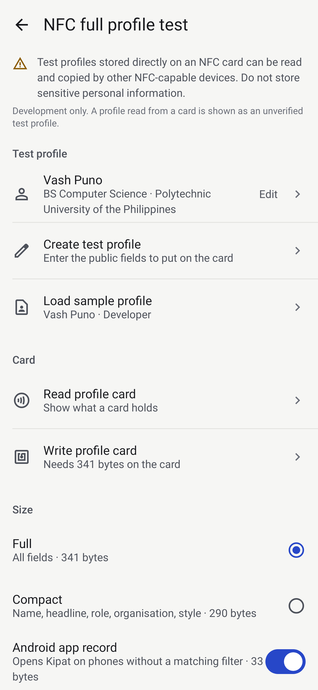
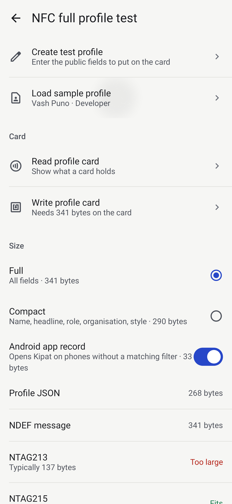
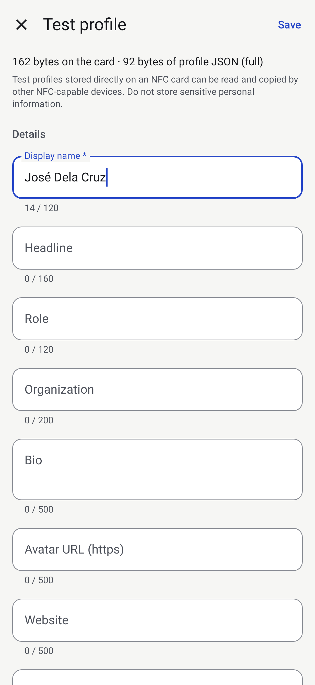

# Self-contained NFC test profile

**Development and testing only.** This puts a complete, public Kipat profile directly on an NFC
card so a physical tap can open the Reveal with no backend. It is not how production cards work.

**It is an offline copy and goes out of date.** Editing your profile or Reveal never changes a
self-contained card. Developer tools labels a stale card **Out of date** ("Tap card to update"),
and **Convert to linked Kipat card** turns it into a linked card that always follows your identity
([nfc-card-identity-sync.md](nfc-card-identity-sync.md)).

> Test profiles stored directly on an NFC card can be read and copied by other NFC-capable
> devices. Do not store sensitive personal information.

## What it is

```
physical NFC card (NDEF: profile MIME record + Android app record)
  → Android NDEF_DISCOVERED, dispatched on the first record's MIME type
  → TapExperienceActivity (same translucent Reveal host as card taps)
  → NfcIntents.recordsFrom(intent)
  → NfcIntentParser.parseTap(records, uri)   → ParsedNfcIntent.Profile | Card | Unknown
  → NfcProfileFormat.parse(payload)          → Valid | UnsupportedVersion | Invalid
  → NfcProfileReveal.toRevealPayload()       → RevealPayload (UNVERIFIED, test profile)
  → RevealScreen (the existing six templates and identity surface)
```

No network, no lookup: everything the Reveal shows came off the card.

## Why it exists

Kipat has no backend yet, but the experience that matters is the **physical tap**: phone meets
card, Reveal appears over whatever app was open. A self-contained profile lets that whole loop be
tested on real hardware today, with real names and real card sizes, instead of only debug links.

## What it proves, and what it doesn't

| Proves | Does not prove |
|---|---|
| A real tag can carry a whole profile and Android routes it to Kipat | That the card is genuine, or that the profile belongs to whoever holds it |
| Parsing, validation and the Reveal mapping work on real payloads | Anything about NTAG 424 DNA / SUN / CMAC authenticity |
| Real NDEF sizes against real `Ndef.getMaxSize` values | Production data flow, privacy model or revocation |
| Reveal timing for a tap that needs no lookup | Behaviour on phones nobody has tested (see the OEM matrix) |

Parsing data is not authenticity. A profile read from a card is always shown as **Unverified
card** with a **Test profile** label, never as verified, whatever the JSON says.

## Format (version 1)

- NDEF record: TNF `MIME_MEDIA`, type `application/vnd.kipat.profile+json`
- Payload: UTF-8 JSON, compact (no whitespace), fixed key order, null fields omitted, non-ASCII
  written as UTF-8 (not `\u` escapes)
- `"v": 1` is required. Any other version shows **"Unsupported Kipat NFC profile version"** and is
  never reinterpreted.

```json
{"v":1,"id":"test-vash-puno","type":"person","name":"Vash Puno","headline":"BS Computer Science","organization":"Polytechnic University of the Philippines","role":"Developer","bio":"Computer Science student and developer.","accent":"cobalt","reveal":"precision_orbit"}
```

| Key | Required | Limit | Notes |
|---|---|---|---|
| `v` | yes | integer | must be `1` |
| `name` | yes | 120 chars | one line; control characters become spaces |
| `id` | recommended | `[A-Za-z0-9_-]{1,64}` | used as the card id (duplicate taps, Connect); otherwise `tp-<hash of name>` |
| `type` | recommended | `person` / `organization` | unknown → person, with a warning |
| `headline` | | 160 | first line under the name |
| `role` | | 120 | under the headline (or in its place) |
| `organization` | | 200 | |
| `bio` | | 500 | Full mode only |
| `avatarUrl` | | 500, `http(s)` with host | **URL only, never image bytes.** The prototype has no network permission, so the monogram is shown |
| `links.website` / `links.github` / `links.linkedin` | | 500 each, `http(s)` with host | Full mode only; shown as text, never opened automatically |
| `publicEmail` | | 254, email syntax | Full mode only |
| `accent` | | `cobalt` `teal` `amber` (`graphite` accepted) | |
| `reveal` | | `contact_ripple` `precision_orbit` `line_assembly` `aperture` `spatial_card` `minimal_fade` (short IDs like `orbit` accepted) | |

Minimal valid profile: `{"v":1,"name":"Vash Puno"}`.

### Validation (hostile input)

The payload is untrusted. The parser never throws; it caps the payload at 4096 bytes, requires
strict UTF-8 and a JSON object, then:

- missing/blank/too-long name, missing or non-integer `v`, malformed JSON → **"Kipat profile
  detected but invalid"** with the reason (the reason never echoes payload text)
- an optional field that breaks a rule (too long, not text, not an `http(s)` URL, bad email,
  unknown accent/template/type) is **dropped with a warning**, not fatal
- unknown keys are ignored
- `intent:`, `javascript:`, `file:` and every other non-web scheme are refused as URLs
- nothing is executed or evaluated; text renders as plain text; no link opens without a tap

Never put on a tag: passwords, authentication tokens, private keys, student portal credentials,
phone unlock information, government ID numbers, financial data, secret API keys.

## Records and their order

| # | Record | Why |
|---|---|---|
| 1 | MIME `application/vnd.kipat.profile+json` | Android dispatches `NDEF_DISCOVERED` on the **first** record; `TapExperienceActivity` has a `mimeType` filter for this type |
| 2 | Android Application Record `com.kipat.probe` (optional, on by default) | Must be last by convention. Makes Android open Kipat (or its store page) even where the MIME filter isn't matched |

**URI routing record: evaluated, not included.** A `https://kipat.app/c/<id>` record would let
a phone without Kipat open a web page, but no such page exists for test profiles, and it costs
bytes on small cards. If both a profile and a Kipat URI are on one tag, the **profile wins**
(`NfcIntentParser.parseTap`); in test mode a URI is only routing.

## Size

Exact size of a record: `1 (header) + 1 (type length) + (1 if payload < 256 else 4) + type + payload`
(no ID). The message size is the sum; unit tests check it against Android's own `NdefMessage`.

| Profile | JSON | NDEF message with AAR | without AAR |
|---|---|---|---|
| Sample, Full | 268 B | **341 B** | 308 B |
| Sample, Compact | 220 B | 290 B | 257 B |
| Name only | 42 B | 112 B | 79 B |

Typical usable capacity (`Ndef.getMaxSize`, NXP data): NTAG213 ≈ 137 B, NTAG215 ≈ 496 B,
NTAG216 ≈ 868 B. **The sample does not fit an NTAG213; use an NTAG215 or NTAG216.** These numbers
are guidance only: the write compares against the card's own reported `maxSize`.

If it doesn't fit, nothing is written (never truncated). The screen shows **PROFILE TOO LARGE**,
the required and available bytes, the bytes each optional field costs (largest first), Compact
mode, and larger cards.

**CBOR** would save an estimated 10–20 % on this payload (not measured: keys stay as strings, only quotes and separators go), but JSON stays: it can be read with any NFC
tool, copied and diffed, and v1 fits NTAG215. CBOR is the option if a future version must fit
NTAG213; it would get its own MIME type and version.

## Developer tool

Profile → Developer tools → **NFC full profile test**.

- **Test profile:** Create test profile, Load sample profile (Vash Puno), Edit
- **Card:** Read profile card, Write profile card
- **Size:** Full / Compact, Android app record on/off, JSON and NDEF bytes live, fit against
  NTAG213/215/216, Copy profile JSON
- Results: fields, profile version, payload size, tag UID, technologies, NDEF type, capacity,
  writable, records; **Preview Reveal**, **Copy JSON**, **Copy diagnostic report**, **Scan another**

While the tool is open it uses **reader mode**, so a card held to the phone is handled in the
tool instead of opening the Reveal; a tap does nothing until Read or Write was chosen. To test the
real tap path, leave the tool first.

Write flow (`NfcProfileSession`): NDEF? → writable? → serialize → exact size vs
`Ndef.getMaxSize` → if the card already has data, confirm *"This NFC card already contains data.
Writing this Kipat test profile will replace the existing NDEF message."* (Cancel / Replace and
write) → write → close → reconnect and read → parse → compare records and profile → only then
**PROFILE WRITE VERIFIED**. A blank `NdefFormatable` card is formatted with the message; its
capacity can't be checked before formatting.

## Production direction

Production cards carry an opaque card identifier (NTAG 424 DNA with SUN/CMAC), resolved by a
backend that checks authenticity and revocation and returns the profile the owner chose to share.
Then a lost card can be revoked, a profile can change without rewriting the card, and nothing
personal sits on the card in clear text. The self-contained format stays a test tool.

## Screens (Robolectric renders, not device captures)

| Tool | Size | Editor | Tap → Reveal |
|---|---|---|---|
|  |  |  |  |
