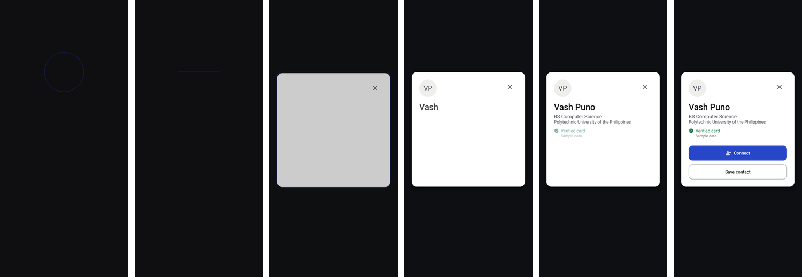

# Reveal

One renderer (`RevealScreen`) serves every entry point: NFC tag, debug deep link, Preview
(Home/Profile) and Replay (Connections).

*Frames above are JVM (Robolectric) renders of the real Compose code, not Higgsfield output and
not device captures.*

## Payload

`RevealPayload`: identityId, cardId, displayName, subtitle, organization, initials, avatarUri
(reserved; initials are the fallback), `AuthenticityState`, template, theme, source, isDemo,
primary/secondary CTA labels, connectable.

- In-app launches use `RevealLauncher`, which encodes the payload as string extras **plus a
  per-process nonce**. Extras without the nonce are ignored, so another app cannot launch a
  spoofed "Verified" Reveal through the exported activity.
- `RevealPayloadCodec.decode` never throws: blank name → "Kipat card", unknown template →
  Signature, unknown authenticity → UNKNOWN, invalid card id / non-https/content avatar → dropped,
  text sanitized and clamped.
- A tag/link that can't be resolved shows a neutral "Kipat card · Card ID" shell, "Not verified",
  and a *Done* button (no Connect).

## Templates

| Template | Implementation |
|---|---|
| Signature (default) | **Full** — one contact ring at the card's top edge, a cobalt line tracing the card from that point down both sides, opaque card (opacity + 0.98→1), name clip-reveal. No particles, glow or drip |
| Particle Bloom | **Full** — opt-in; dots spread out and settle around the card |
| Minimal | **Full** — quick quiet fade, no effects |
| Ripple, Orbit, Soft Glow, Liquid Logo, Line Trace, Pixel Build, Constellation | Parameterised on the same primitives (`RevealConfig`) |

All templates share `effects/RevealEffects.kt`; there are no per-template engines.

## Timeline (product targets, not measurements)

Signature v2 (derived from `design/higgsfield/critique-v2.md`):

| ms | Beat |
|---|---|
| 0 | first frame: scrim fades to 55%; contact ring at the card's top edge; start haptic |
| 300–650 | edge trace runs from the contact point down both sides |
| 500–800 | card surface resolves; scrim deepens to 82% |
| 700 | avatar |
| 850 | name (left-to-right clip reveal) |
| 950 | role / organisation |
| 1100 | trust line (verified haptic only if AUTHENTIC) |
| 1250 | actions; settled at 1550 |

Actions: **Connect** (primary; "Done" for an unresolved card), **Save contact** (Android contact
editor via ACTION_INSERT), **Open profile** (only when there is a Kipat profile to open: an
existing connection or your own preview). The card follows the system light/dark theme; the
scrim is always graphite.

The spec's "0–100 ms activity launch" target is **not** claimed. The earlier OPPO probe measured
~190 ms warm launch; nothing has been measured on a device for this build.

## Fallbacks

- **Reduced motion** (`ValueAnimator.areAnimatorsEnabled() == false`): no ring/trace/particles,
  one 200 ms fade, everything readable immediately.
- **Low-end** (low-RAM flag or ≤ 4 cores): ≤ 12 particles and 1 ripple for templates that use them (Signature has neither).
- Rotation: elapsed time is saved, the Reveal resumes rather than replays.
- Home/app switch: activity finishes in `onStop`.
- Duplicate NFC scan of the same card within 1.5 s: ignored.
- Identity text is always in the layout (alpha-animated only) and exposed to TalkBack; the close
  button is always available.

## Instrumentation

`RevealTrace` logs to `KipatReveal` and emits `android.os.Trace` sections:
`activity_create` (with `launch→create` for in-app launches), `content_set`, `first_frame`,
`first_reveal_visual`, `reveal_complete`. Profile → Developer tools lists this session's
measurements. Use Perfetto on real devices for authoritative numbers.

## Smoke tests

- JVM: `AppSmokeTest` (Robolectric) — manifest routing, cold deep-link launch, dynamic content,
  dismiss, spoofed-extra rejection.
- Device (not yet run): `adb shell am start -W -a android.intent.action.VIEW -d "kipatprobe://tap/TEST123"`,
  then check it appears over the previous app and Back/✕ returns to it.
