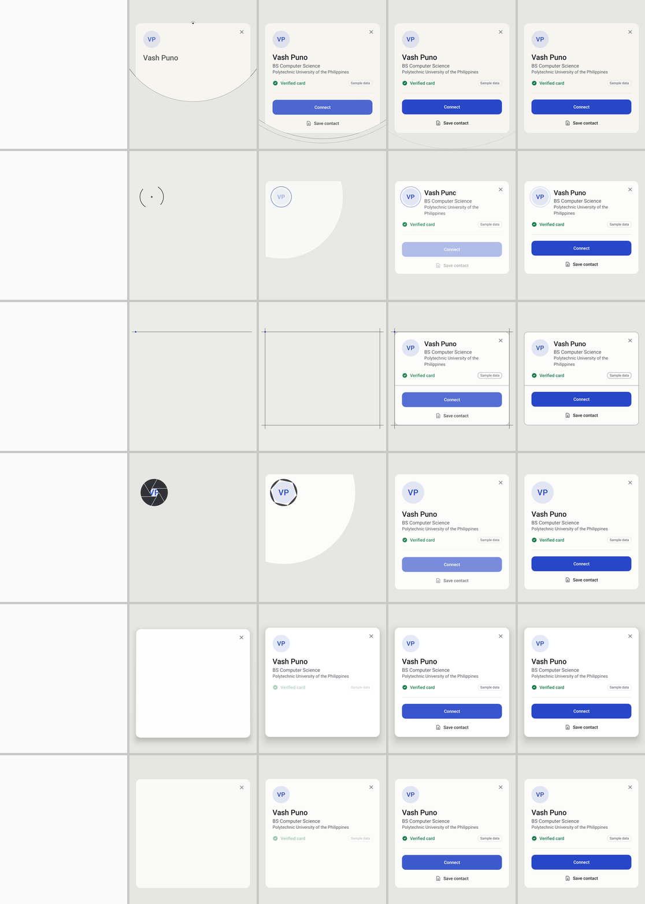
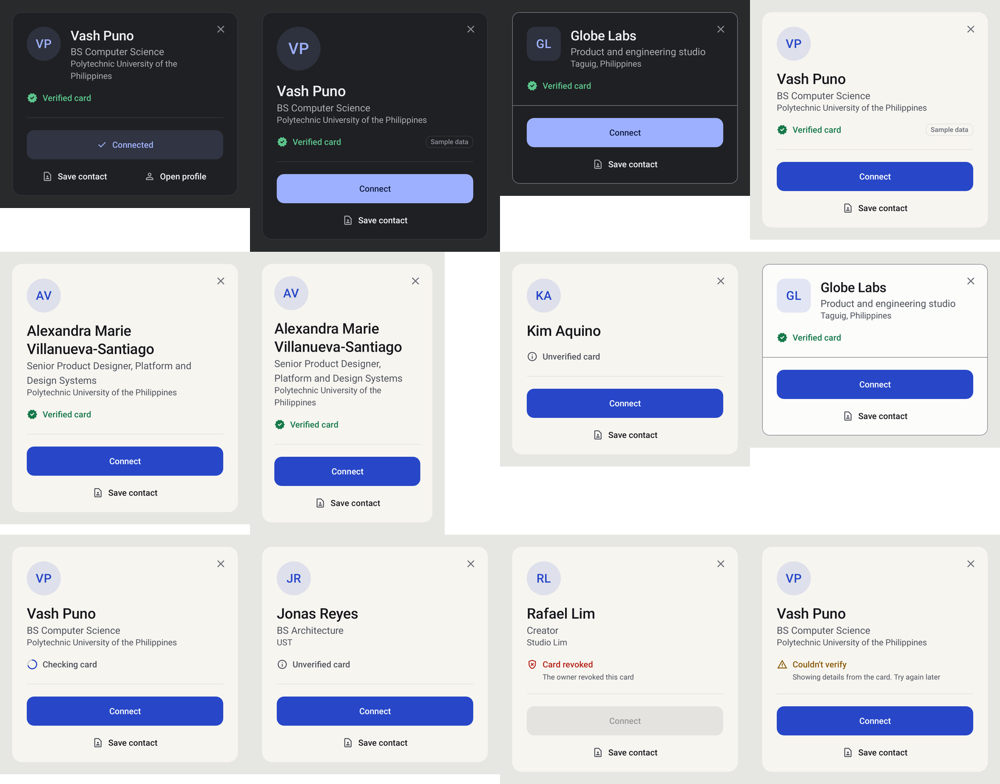
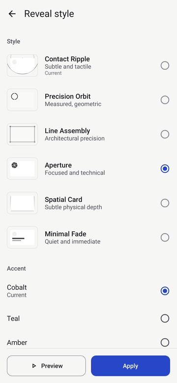

# Reveal

One renderer (`RevealScreen`) serves every entry point: NFC tag, debug deep link, Preview
(Home/Profile) and Replay (Connections).

*Rows top to bottom: Contact Ripple, Precision Orbit, Line Assembly, Aperture, Spatial Card,
Minimal Fade. JVM (Robolectric) renders of the real Compose code, not Higgsfield output and not
device captures; the scrim sits over a blank window here, not a real app. Dark theme:
[images/reveal-templates-dark.png](images/reveal-templates-dark.png).*

## Payload

`RevealPayload`: identityId, cardId, displayName, subtitle, organization, initials, avatarUri
(reserved; initials are the fallback), `AuthenticityState`, template, theme, source, isDemo,
primary/secondary CTA labels, connectable.

- In-app launches use `RevealLauncher`, which encodes the payload as string extras **plus a
  per-process nonce**. Extras without the nonce are ignored, so another app cannot launch a
  spoofed "Verified" Reveal through the exported activity.
- `RevealPayloadCodec.decode` never throws: blank name → "Kipat card", unknown template →
  the default template (legacy v1/v2 IDs map to the closest current template), unknown authenticity → UNKNOWN, invalid card id / non-https/content avatar → dropped,
  text sanitized and clamped.
- A tag/link that can't be resolved shows a neutral "Kipat card · Card ID" shell, "Not verified",
  and a *Done* button (no Connect).

## Identity surface

Every template settles into the same object, `KipatIdentitySurface` (design:
`design/reveal-surface/`). It is also Profile's "How others see you".

- **Order:** identity (anchor + name), context (role, then organisation, quieter), trust, then
  attached actions. Content-driven height (≈ 280–370 dp); scrolls only if content is unusually long.
- **Width:** screen − 40 dp, max 380 dp. Padding 24 dp (20 dp below 340 dp). Radius 16 dp (12 dp
  structural).
- **Anchor:** photo (`content://`), organisation logo (rounded square) or a designed monogram: the
  person's accent at 12% with the initials in the accent. Never a grey placeholder disc.
- **Name:** 22–24 sp, weight 500, wraps up to three lines.
- **Trust row:** one glyph + the state in words, inside the identity block. Demo = a small
  "Sample data" chip on the same row. A detail line only for revoked / couldn't verify. Checking is
  a static arc (no spinner); unverified is neutral; revoked is red but plain; couldn't verify is
  amber.
- **Actions:** Connect (filled accent, 48 dp, no decorative icon; "Connected" is a settled accent
  tint, not disabled grey), then Save contact / Open profile as a light icon + label row.
- **Close:** a 48 dp target with a quiet 20 dp ✕ in the same top-end corner for every layout;
  backdrop tap and Back also dismiss.

Layouts and materials are curated per template (`RevealPresentation`):

| Template | Layout | Treatment |
|---|---|---|
| Contact Ripple | Compact (stacked) | Tonal |
| Precision Orbit | Profile header (row) | Paper |
| Line Assembly | Profile header (row) | Structural |
| Aperture | Editorial (72 dp anchor) | Paper |
| Spatial Card | Compact | Floating |
| Minimal Fade | Compact | Paper |

States and hard content (long name, 320 dp phone, no context, company, every trust state):

## Templates

Six interpretations of one card (design: `design/reveal-templates/`). Each has exactly **one primary
motion**, plus the surface resolving and text staging. Shared: `RevealStage` (one renderer),
`effects/RevealEffects.kt` (one file of primitives), `IdentityBlock` and `RevealActions`.

| Template (wire ID) | Primary motion | Surface | Name | Settled |
|---|---|---|---|---|
| **Contact Ripple** (`ripple`, default) | Contact dot; one ring from the card's top centre is the edge of a circular reveal that uncovers surface *and* content; a fainter second ring | circular reveal from the contact point | fade | 900 ms (actions at 680) |
| Precision Orbit (`orbit`) | Two symmetric arcs turn 90° once, close, tighten onto the avatar and turn accent; the surface then grows out of the ring | circular reveal from the avatar | wipe | 1160 ms |
| Line Assembly (`lines`) | Accent corner mark; top and left drafting lines drawn with 12 dp overshoot; right and bottom fade in; material and content fill inside; lines leave | fade | wipe | 1200 ms |
| Aperture (`aperture`) | Six flat blades over the avatar turn −5°, open to the rim (+12°), fade as slivers; the surface then unfolds from the anchor | circular reveal from the avatar | fade | 1080 ms |
| Spatial Card (`spatial`) | The surface arrives with its content, tilted 6° (pivot: bottom edge) showing a 3 dp edge; settles flat on a ζ 0.9 spring; shadow forms (light) | tilt | fade | 700 ms |
| Minimal Fade (`minimal-fade`, low-power) | None: fade + 10 dp rise | fade-rise | fade | 620 ms |

Legacy IDs on already-written cards: `drip`, `particle-bloom`, `soft-glow`, `liquid-logo`,
`pixel-build`, `constellation` → default; `line-trace` → Line Assembly.

Colour: one ink per theme for every primitive (graphite on a paper scrim in light, mist on a
graphite scrim in dark); the person's accent only at completion (orbit ring, corner mark) and on
Connect. No particles, glow, gradients, blur or sound in any template.

A template's clock stops at `max(actions settled, primitive finished)`; after that the frame is
completely static (Spatial Card's tilt snaps to exactly 0).

**Picker** (Profile → Reveal style): a live preview at the top plays the selection once on the
recipient's surface and holds the settled frame (Replay to play again; static when system
animations are off). Below: rows with a static thumbnail drawn with the template's own
primitives, the name and one line of character, selected by a tonal background and a check; the
accents as real colour swatches. Selecting only changes the draft ("Not applied yet");
**Preview** plays it full screen; **Apply** makes it what others see.

## Timeline (product targets, not measurements)

Per-template beats are in each `design/reveal-templates/<template>.md`; card/text timing is
`RevealTimeline`. Motion curves (`KipatEasing`): M3 standard, M3 emphasized decelerate, M3
emphasized, M3 emphasized accelerate, and a 0.9-damped spring (stiffness 300) for Spatial Card.
Nothing overshoots visibly.

Actions: **Connect** (primary; "Done" for an unresolved card), **Save contact** (Android contact
editor via ACTION_INSERT), **Open profile** (only when there is a Kipat profile to open: an
existing connection or your own preview). Surface, backdrop and ink follow the system light/dark
theme.

The spec's "0–100 ms activity launch" target is **not** claimed. The earlier OPPO probe measured
~190 ms warm launch; nothing has been measured on a device for this build.

## Fallbacks

- **Reduced motion** (`ValueAnimator.areAnimatorsEnabled() == false`): each template's own
  equivalent, all 200 ms and readable from the first frame: Contact Ripple → the contact dot
  fades in and out once; Precision Orbit → the settled ring fades in; Line Assembly → the four
  lines fade out; Aperture and Minimal Fade → crossfade; Spatial Card → 0.98→1 scale + opacity.
  Nothing moves, rotates, masks or tilts.
- **Low-end** (low-RAM flag or ≤ 4 cores): same choreography (every primitive is a handful of
  draw calls, no offscreen buffers, no per-frame allocation); the animated shadow is skipped.
  Minimal Fade is the recommended low-power template.
- Rotation: elapsed time is saved, the Reveal resumes rather than replays.
- Home/app switch: activity finishes in `onStop`.
- Duplicate NFC scan of the same card within 1.5 s: ignored.
- Identity text is always in the layout (alpha-animated only) and exposed to TalkBack; the close
  button is always available.

## Instrumentation

`RevealTrace` logs to `KipatReveal` and emits `android.os.Trace` sections:
`activity_create` (with `launch→create` for in-app launches), `content_set`, `first_frame`,
`first_reveal_visual`, `identity_readable` (name and role fully shown), `reveal_complete`. Profile → Developer tools lists this session's
measurements. Use Perfetto on real devices for authoritative numbers.

## Real-device validation

Not yet done on hardware. The kit, procedure and off-device preflight findings are in
`docs/device-validation/` (`tools/device-validation/kipat-device-validate.sh`).

## Smoke tests

- JVM: `AppSmokeTest` (Robolectric) — manifest routing, cold deep-link launch, dynamic content,
  dismiss, spoofed-extra rejection.
- Device (not yet run): `adb shell am start -W -a android.intent.action.VIEW -d "kipatprobe://tap/TEST123"`,
  then check it appears over the previous app and Back/✕ returns to it.
